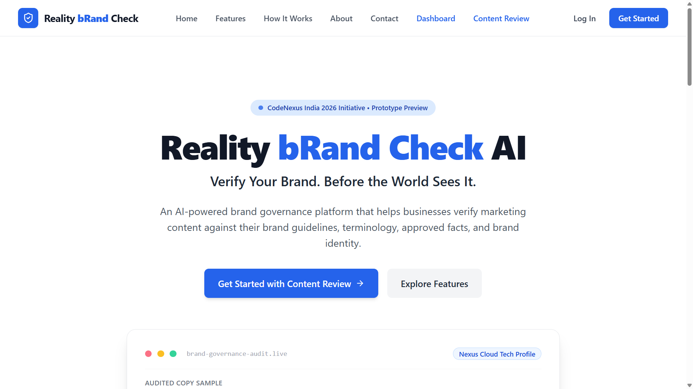
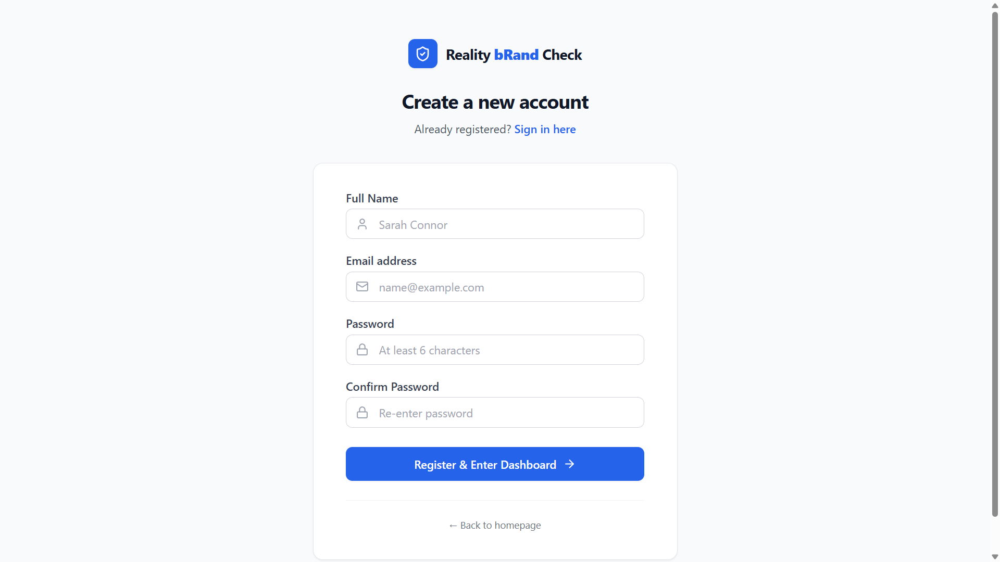
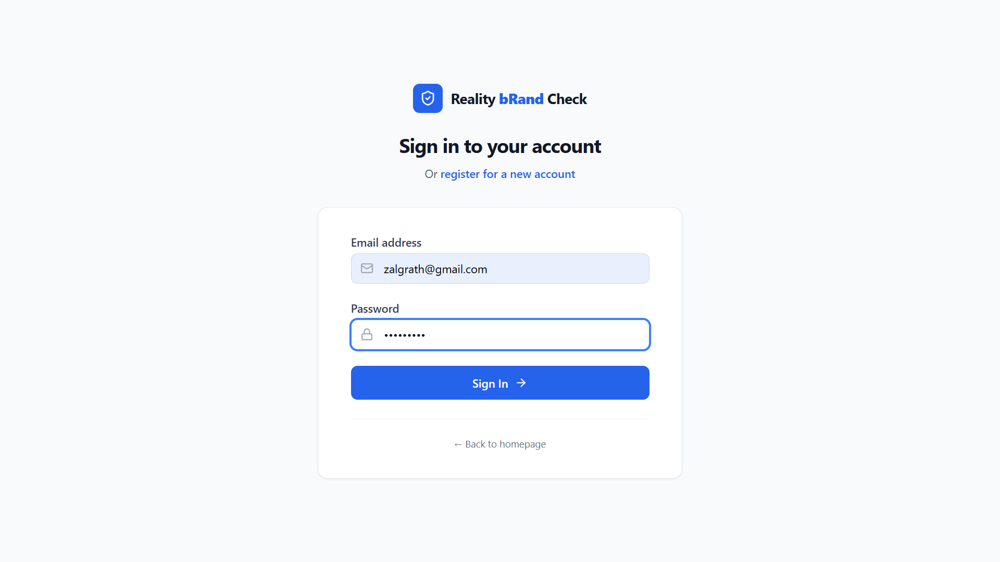
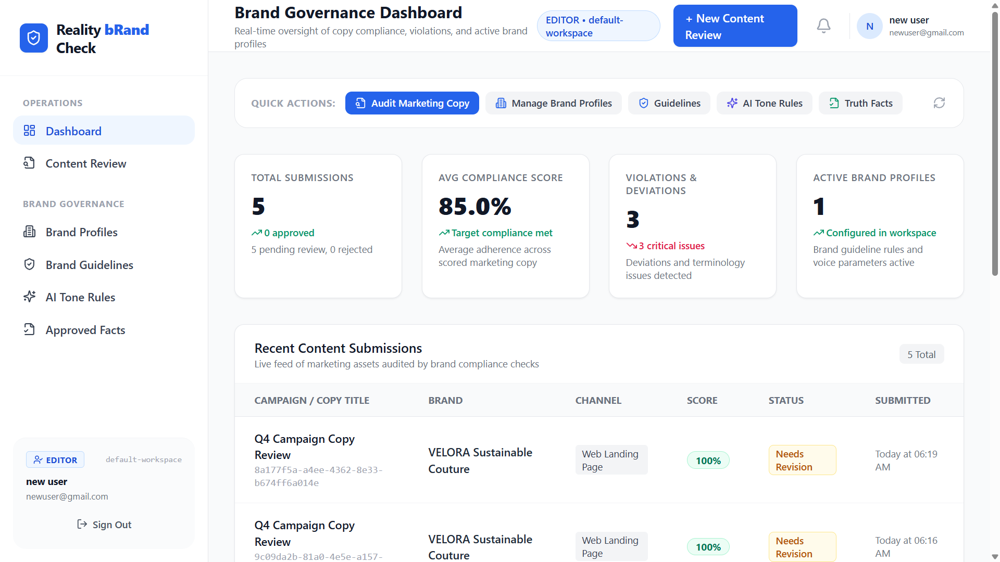
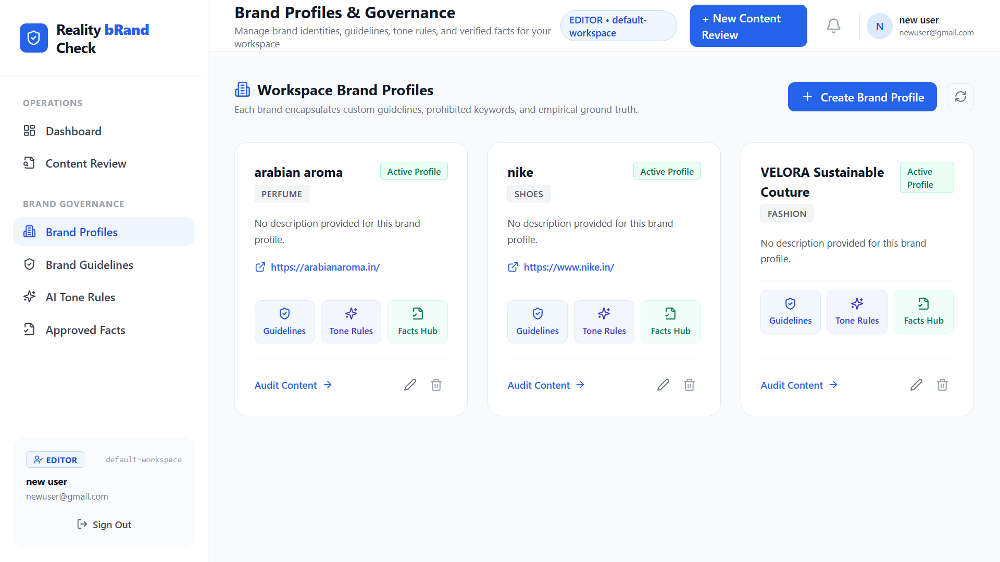
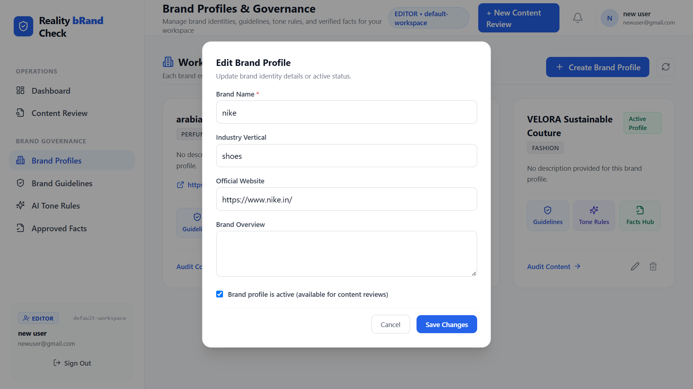
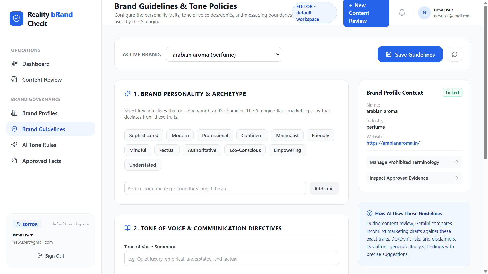
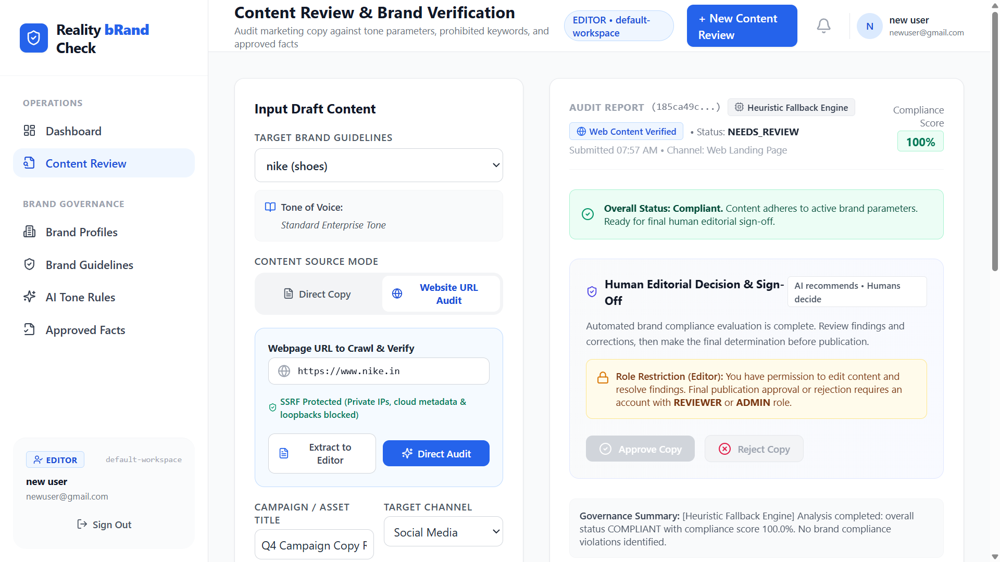
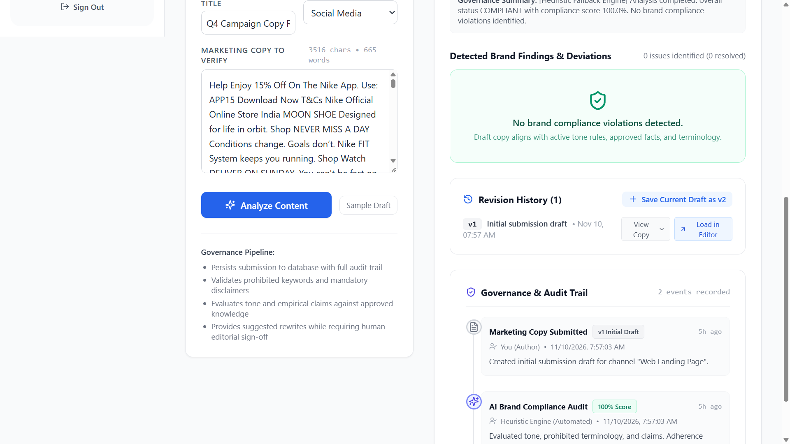
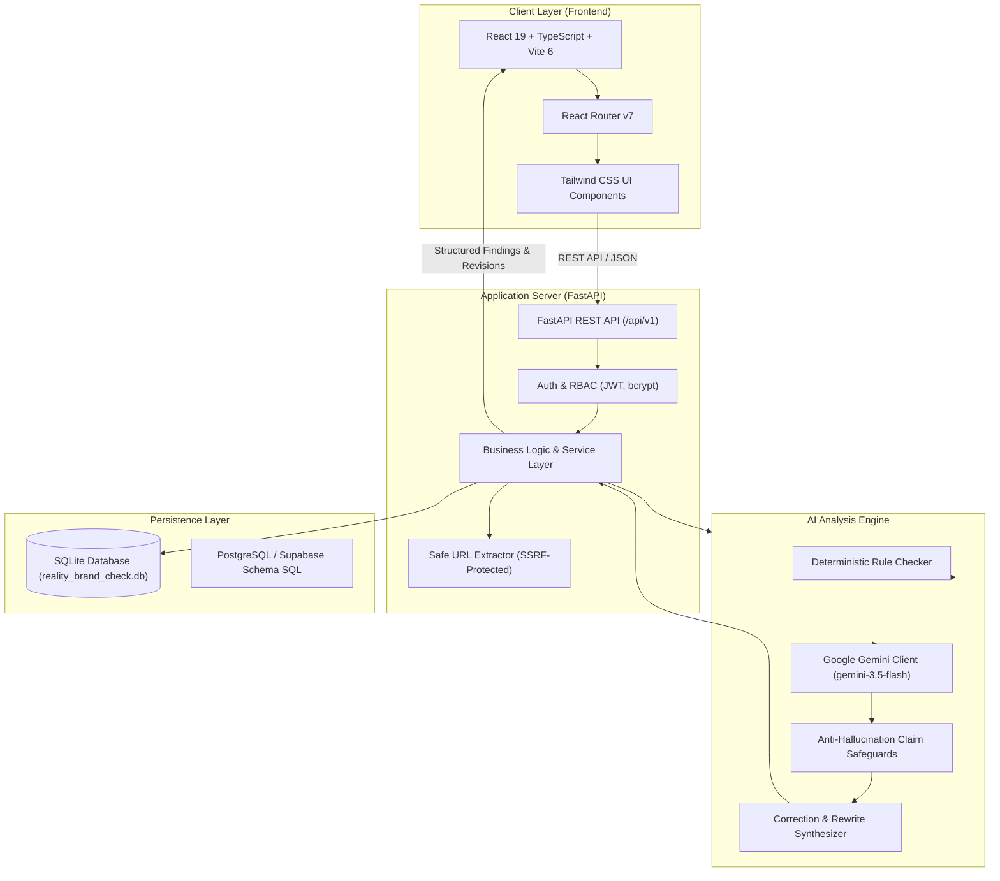

# Reality bRand Check AI

> **"Verify Your Brand. Before the World Sees It."**

An AI-powered brand governance and compliance platform designed to audit marketing copy, campaign drafts, and promotional content against brand guidelines, terminology dictionaries, and approved ground-truth facts before publication.

[](https://github.com/debasmithrout/Reality-bRand-Check-AI)
[](https://github.com/debasmithrout/Reality-bRand-Check-AI)
[-success.svg)](https://github.com/debasmithrout/Reality-bRand-Check-AI)
[](https://fastapi.tiangolo.com)
[](https://react.dev)
[](https://ai.google.dev)
[](https://github.com/debasmithrout/Reality-bRand-Check-AI)
[](LICENSE)

---

## Table of Contents

1. [Project Overview](#1-project-overview)
2. [Application Screenshots](#2-application-screenshots)
3. [Problem Statement and Product Goal](#3-problem-statement-and-product-goal)
4. [Target Users and Roles](#4-target-users-and-roles)
5. [Core Features and Implemented Scope](#5-core-features-and-implemented-scope)
6. [Technical Architecture](#6-technical-architecture)
7. [End-to-End Workflow](#7-end-to-end-workflow)
8. [Security, Privacy, and Responsible AI](#8-security-privacy-and-responsible-ai)
9. [Demonstration Scenario: VELORA](#9-demonstration-scenario-velora)
10. [Installation and Local Setup](#10-installation-and-local-setup)
11. [Environment Variables](#11-environment-variables)
12. [Testing and Quality Assurance](#12-testing-and-quality-assurance)
13. [Limitations and Validation Items](#13-limitations-and-validation-items)
14. [Future Scope](#14-future-scope)
15. [Team and Contributions](#15-team-and-contributions)
16. [Project Closure and Handover](#16-project-closure-and-handover)
17. [Glossary](#17-glossary)
18. [Project Links](#18-project-links)

---

## 1. Project Overview

**Reality bRand Check AI** is an AI-assisted brand governance platform that empowers marketing teams, brand guardians, and content creators to audit written collateral prior to public distribution. By benchmarking copy against a structured, brand-specific knowledge base, the system automatically detects tone mismatches, prohibited terminology, unsupported marketing assertions, and contradictory factual statements.

Rather than acting as an autonomous publishing black box, the platform operates under a strict **human-in-the-loop** paradigm:
- **AI findings are advisory**, highlighting exact character spans, rule categories, and risk severities.
- **Original content is preserved**, allowing authors to generate numbered revision drafts without destructive overwrites.
- **Authorized human reviewers retain final sign-off authority**, ensuring human judgment governs public releases.

The platform embodies the core operational principle defined in the Product Requirements Document (PRD v2.0):

$$\mathbf{Understand} \longrightarrow \mathbf{Verify} \longrightarrow \mathbf{Detect} \longrightarrow \mathbf{Explain} \longrightarrow \mathbf{Suggest} \longrightarrow \mathbf{Approve}$$

---

## 2. Application Screenshots

The following screenshots capture the verified user journeys across the implemented React and FastAPI application.

### 2.1 Landing Page
The public landing page introduces Reality bRand Check AI, highlighting the brand governance value proposition, core capabilities, and navigation entry points.



### 2.2 User Registration
Account creation interface supporting role-aware registration into workspace tenancies with instant validation.



### 2.3 User Login
Secure authentication interface issuing JSON Web Tokens (JWT) for authenticated session persistence.



### 2.4 Brand Governance Dashboard
The centralized operational command center providing real-time metrics (Total Submissions, Average Compliance Score, Violations & Deviations, Active Brand Profiles), quick navigation actions, and recent audit activity.



### 2.5 Brand Profile Management
Workspace brand portfolio management displaying active profile cards (e.g., VELORA Sustainable Couture, Nike, Arabian Aroma) with links to their respective guidelines, tone policies, and ground-truth facts.



*Brand profile creation and editing modal with active status toggle:*


### 2.6 Brand Guidelines & Tone Policies
Interactive brand configuration hub supporting personality archetype selection, custom adjective tags, tone of voice communication directives, and brand context linking.



### 2.7 Content Review and Brand Verification
Interactive content auditing interface with dual source modes: direct marketing copy editing and SSRF-protected website URL extraction with compliance scoring.



### 2.8 Analysis Findings, Revision History & Audit Trail
Detailed compliance evaluation showing detected deviations, suggested rewrites, revision tracking (draft versioning), and immutable governance audit logging.



---

## 3. Problem Statement and Product Goal

### The Problem
Modern organizations generate vast volumes of marketing content across decentralized teams, external agencies, and generative AI writing assistants. As publication channels proliferate, maintaining consistent brand standards encounters severe operational challenges:
1. **Tone Drift:** Inconsistent voice across social channels, microsites, email campaigns, and retail copy.
2. **Prohibited & Outdated Terminology:** Accidental usage of deprecated terms, superlatives, or legally risky promotional jargon.
3. **Unsubstantiated Marketing Claims:** Overpromising claims lacking benchmark data, exposing organizations to regulatory scrutiny and reputational loss.
4. **Factual Contradictions:** Promotional statements that conflict directly with certified product specifications or sustainability benchmarks.

### Product Goal
Reality bRand Check AI establishes an automated, deterministic, and explainable governance layer that validates content against brand-approved guidelines before public visibility, preventing brand damage through structured verification.

---

## 4. Target Users and Roles

The system defines five target roles across enterprise and agency brand operations:

| Role | Operational Scope & Responsibilities | Key Capabilities |
| :--- | :--- | :--- |
| **Content Creator** | Drafts marketing collateral, submits copy for verification, reviews findings, and iterates on revisions. | Submit content, trigger AI analysis, view findings, apply suggested rewrites, save revision drafts (`v1`, `v2`). |
| **Marketing Manager** | Coordinates campaign workflows, monitors compliance averages, and tracks submissions requiring editorial attention. | Workspace dashboard analytics, status filtering, review pipeline visibility. |
| **Brand Manager / Admin** | Establishes and governs brand identities, tone parameters, terminology dictionaries, and approved ground-truth facts. | Full CRUD over Brand Profiles, Brand Guidelines, Terminology (`PREFERRED` vs `PROHIBITED`), and Approved Facts. |
| **Reviewer / Approver** | Conducts editorial governance sign-off. Evaluates compliance findings, requests revisions, and issues approvals/rejections. | Sign-off approval (`APPROVED`), formal rejection (`REJECTED`) with mandatory feedback. Protected by anti-self-approval controls. |
| **Agency Collaborator** | External partner contributing campaign drafts within restricted workspace permissions. | Workspace-scoped submission and revision workflow without administrative access to brand rules. |

---

## 5. Core Features and Implemented Scope

The implemented MVP encompasses the full functional scope specified in Section 4 of the PRD:

- **Authentication & RBAC:** Email/password authentication, `bcrypt` password hashing, HS256 JWT access tokens, role-aware routing (`ADMIN`, `EDITOR`, `REVIEWER`).
- **Workspace & Tenant Isolation:** Multi-tenant workspace architecture. Cross-workspace resource inspection is blocked with HTTP 403 `FORBIDDEN`.
- **Brand Knowledge Hub:**
  - *Brand Profiles:* Workspace brand CRUD, active/inactive state management.
  - *Brand Guidelines:* Brand personality tag cloud, communication directives, Dos and Don'ts lists, positioning rules.
  - *AI Tone Rules:* Searchable dictionary of `PROHIBITED` and `PREFERRED` terms with canonical casing replacements.
  - *Approved Facts Hub:* Repository of certified ground-truth assertions with benchmark evidence and external citations.
- **AI Content Analysis Pipeline:** 7-stage evaluation pipeline combining deterministic regex scanners, Gemini LLM evaluation (`gemini-3.5-flash`), anti-hallucination claim safeguards, and fallback indicators.
- **Safe Website URL Extraction:** Server-Side Request Forgery (SSRF)-protected crawler service capable of extracting clean text from external URLs for audit.
- **Explainable Findings:** Identified issues mapped to specific character spans with rule category, severity level (`INFO`, `WARNING`, `CRITICAL`), explanation, and remediation suggestion.
- **Revision Workflow:** Immutable version history tracking (`v1`, `v2`, etc.) allowing creators to update copy without destroying audit history.
- **Human Approval & Anti-Self-Approval:** Independent review sign-off. Creators cannot approve their own submissions; rejections mandate explanatory comments.
- **Governance Audit Trail:** Timestamped event logging of submission creation, AI audits, resolved findings, and review decisions.
- **Dashboard Analytics:** Aggregation of total submissions, average compliance scores, active violation counts, and workspace brand tallies.

---

## 6. Technical Architecture

### Architecture Overview



### Component Breakdown
- **Frontend:** React 19, TypeScript 5.7, Vite 6, Tailwind CSS 3.4, Lucide React icons.
- **Backend:** Python 3.14 / 3.11+, FastAPI 0.115, Pydantic v2, SQLAlchemy 2.0 ORM, PyJWT, passlib/bcrypt.
- **AI Integration:** Google Gemini API via official `google-genai` SDK (`gemini-3.5-flash` model), augmented with fast deterministic fallback heuristics when offline.
- **Persistence:** Local SQLite database (`reality_brand_check.db`). Prepared PostgreSQL/Supabase schema with Row Level Security (RLS) policies (`backend/database/schema.sql`).
- **Web Extraction:** Standard library `html.parser` DOM stripper with `httpx` async client, socket DNS resolution, and `ipaddress` validation.

---

## 7. End-to-End Workflow

The platform operationalizes brand governance in 8 distinct steps:

```
[1. Sign In] ──────> [2. Load Brand Context] ──────> [3. Submit Copy / URL]
                                                              │
                                                              ▼
[6. Author Revisions] <── [5. Review Findings] <── [4. AI Compliance Audit]
         │
         ▼
[7. Editorial Decision] ───> [8. Dashboard & Audit Trail]
 (Approve / Reject)
```

1. **Authentication:** User authenticates via JWT and enters their authorized workspace.
2. **Context Resolution:** The brand guidelines, prohibited terminology, and approved facts for the selected brand profile are loaded.
3. **Content Ingestion:** The creator inputs text directly or inputs an external URL (triggering the SSRF-safe HTML text extractor).
4. **AI Compliance Audit:** The backend coordinates deterministic checks (case sensitivity, blacklisted phrases) and Gemini contextual claim verification.
5. **Findings Display:** Findings are presented with severity badges, matched text highlights, and actionable rewrite recommendations.
6. **Revision Authoring:** The creator resolves issues or applies suggestions, saving the updated draft as a new version (`v2`).
7. **Editorial Review:** An authorized reviewer (with `REVIEWER` or `ADMIN` role, distinct from the submission author) signs off with `APPROVED` or returns `REJECTED` with mandatory feedback.
8. **Audit Persistence:** The dashboard updates real-time compliance metrics, and the submission timeline archives the immutable audit trail.

---

## 8. Security, Privacy, and Responsible AI

Reality bRand Check AI implements responsible AI practices and robust security boundaries:

- **Advisory AI Findings:** AI outputs are treated as editorial recommendations, not infallible legal or factual determinations.
- **Epistemic Modesty:** Claims lacking supporting evidence in the knowledge base are flagged as `UNSUPPORTED` or `NEEDS_REVIEW`, never falsely labelled as verified or fabricated.
- **Content Integrity:** Original submitted text is never destructively overwritten; revisions are stored as separate versioned artifacts.
- **Human Authority:** The platform enforces human sign-off; AI cannot autonomously publish or approve collateral.
- **Server-Side Secret Custody:** `GEMINI_API_KEY` and JWT secret keys remain strictly on the backend. No credentials are leaked to the browser or committed to version control.
- **Multi-Layer SSRF Defense:** External URL extraction explicitly blocks loopback IPs (`127.0.0.0/8`, `::1`), private subnets (`10.0.0.0/8`, `172.16.0.0/12`, `192.168.0.0/16`), link-local blocks (`169.254.0.0/16`), and cloud instance metadata services (`169.254.169.254`, `metadata.google.internal`). Response streams are hard-capped at 2MB with a maximum of 3 validated redirect hops.

---

## 9. Demonstration Scenario: VELORA

To demonstrate the platform's multi-layered audit capabilities without compromising proprietary data, the repository includes a fictional demonstration brand:

**Brand:** VELORA Sustainable Couture<br />
**Industry:** Sustainable Luxury Fashion & Performance Footwear<br />
**Positioning:** Understated, empirical, circular luxury
**Demonstration Ground-Truth Facts:**
- `FACT-VEL-01`: *"All VELORA running shoes are crafted from 40% certified organic cotton and 60% ocean-reclaimed marine polymer."*
- `FACT-VEL-02`: *"Independent lab testing demonstrates an 18% energy return cushioning profile across standard marathon cycles."*

### Problematic Test Copy
```text
"VELORA Sustainable Couture presents our newest footwear! BUY NOW!!! CRAZY DEAL!!!
Our shoes make you run 50% faster! Introducing the VELORA RUN-X PRO MAX, engineered with 100% organic guaranteed materials."
```

### Audited Findings Output
1. **`BUY NOW`** — `TERMINOLOGY` (Severity: `HIGH`, Status: `VIOLATION`): Aggressive call-to-action violates understated tone.
2. **`CRAZY DEAL`** — `TERMINOLOGY` (Severity: `HIGH`, Status: `VIOLATION`): Superlative discount language prohibited.
3. **Multiple Exclamation Marks (`!!!`)** — `BRAND_TONE` (Severity: `HIGH`, Status: `VIOLATION`): Hyperbolic urgency deviates from sophisticated luxury guidelines.
4. **`run 50% faster`** — `CLAIM_VERIFICATION` (Severity: `CRITICAL`, Status: `CONTRADICTED`): Directly contradicted by certified 18% energy return specification (`FACT-VEL-02`).
5. **`PRO MAX`** — `BRAND_CONSISTENCY` (Severity: `MEDIUM`, Status: `VIOLATION`): Unapproved technology modifier applied to canonical product name `VELORA RUN-X`.
6. **`100% organic guaranteed`** — `CLAIM_VERIFICATION` (Severity: `CRITICAL`, Status: `CONTRADICTED`): Contradicts certified material breakdown of 40% organic / 60% ocean polymer (`FACT-VEL-01`).

*Compliance Score:* **25.0 / 100.0 (FAIL)**<br />
*Suggested Compliant Revision:*
> *"VELORA Sustainable Couture presents our newest footwear. Experience the latest chapter in sustainable performance. Engineered with responsive cushioning providing an 18% energy return, the VELORA RUN-X is crafted with 40% certified organic cotton and 60% ocean-reclaimed polymer."*

---

## 10. Installation and Local Setup

Follow these verified steps to run the complete stack locally.

### Prerequisites
- **Python:** 3.11, 3.12, 3.13, or 3.14
- **Node.js:** 18.x or later (Node 20+ recommended)
- **Package Managers:** `pip` and `npm`
- **Git**

### 1. Clone Repository
```bash
git clone https://github.com/debasmithrout/Reality-bRand-Check-AI.git
cd Reality-bRand-Check-AI
```

### 2. Backend Setup
```bash
# Navigate to repository root (or backend directory)
# Create a Python virtual environment
python -m venv venv

# Activate virtual environment
# Windows (PowerShell):
.\venv\Scripts\Activate.ps1
# macOS / Linux:
source venv/bin/activate

# Install backend dependencies
pip install -r backend/requirements.txt

# Configure environment variables
cp .env.example .env
```

Edit `.env` to configure your settings (see [Environment Variables](#11-environment-variables)). For basic testing without live LLM calls, the backend runs seamlessly using built-in deterministic heuristic fallbacks.

```bash
# Start FastAPI backend server with hot reload
python -m uvicorn app.main:app --app-dir backend --host 127.0.0.1 --port 8000 --reload
```

- Backend API: [http://127.0.0.1:8000](http://127.0.0.1:8000)
- Interactive Swagger UI: [http://127.0.0.1:8000/docs](http://127.0.0.1:8000/docs)
- Health Check: [http://127.0.0.1:8000/api/v1/health](http://127.0.0.1:8000/api/v1/health)

### 3. Frontend Setup
Open a second terminal:

```bash
cd frontend

# Install dependencies
npm install

# Optional: configure frontend environment
cp .env.example .env

# Start Vite development server
npm run dev
```

- Frontend Application: [http://localhost:5173](http://localhost:5173)

---

## 11. Environment Variables

The backend loads configuration from `.env` in the project root via `pydantic-settings`. The variables defined in `.env.example` include:

| Variable | Description / Purpose | Default / Example Value | Required |
| :--- | :--- | :--- | :--- |
| `ENVIRONMENT` | Deployment environment identifier (`development`, `staging`, `production`) | `development` | No |
| `DEBUG` | Enable verbose application and reload logging | `True` | No |
| `PORT` | Local port for FastAPI Uvicorn server | `8000` | No |
| `HOST` | Binding interface for Uvicorn | `0.0.0.0` | No |
| `SECRET_KEY` | Symmetric key used to sign and verify JWT access tokens | `reality-brand-check-ai-super-secret-key-change-in-prod` | **Yes (in prod)** |
| `ALLOWED_ORIGINS` | Comma-separated CORS allowed origin URLs | `http://localhost:3000,http://localhost:5173,http://127.0.0.1:3000,http://127.0.0.1:5173` | No |
| `DATABASE_URL` | SQLAlchemy connection string | `sqlite:///./reality_brand_check.db` | Yes |
| `GEMINI_API_KEY` | Google Gemini API Key for LLM-powered claim analysis | `your_gemini_api_key_here` | Optional (heuristic fallback active if omitted) |
| `GEMINI_MODEL` | Google Gemini model identifier | `gemini-3.5-flash` | No |
| `GEMINI_TIMEOUT` | Timeout in seconds for remote Gemini API requests | `30.0` | No |
| `SUPABASE_URL` | Supabase project URL for PostgreSQL integration | `https://[YOUR-PROJECT-REF].supabase.co` | No |
| `SUPABASE_ANON_KEY` | Supabase public anonymous API key | `your_supabase_anon_key_here` | No |
| `SUPABASE_SERVICE_ROLE_KEY` | Supabase administrative service role key | `your_supabase_service_role_key_here` | No |
| `SUPABASE_JWT_SECRET` | Supabase JWT signing secret | `your_supabase_jwt_secret_here` | No |
| `VITE_API_BASE_URL` | Frontend API proxy endpoint pointing to FastAPI backend | `http://localhost:8000/api/v1` | Yes |

> [!TIP]
> **Obtaining a Gemini API Key:** You can generate a free API key from [Google AI Studio](https://aistudio.google.com/). Add `GEMINI_API_KEY="AIzaSy..."` to your `.env` file. Never commit `.env` to version control.

---

## 12. Testing and Quality Assurance

### Reported PRD Baseline vs. Fresh Verification

The PRD v2.0 historically reported a baseline of 124 backend tests and 39 frontend tests. Following the completion of the Governance suite, RBAC hardening, and SSRF-safe URL extraction, the test suite was expanded and freshly re-executed across the `main` branch:

| Metric | PRD v2.0 Reported Baseline | Fresh Verification on `main` (10 Nov 2026) | Verification Status |
| :--- | :--- | :--- | :--- |
| **Backend Tests (Pytest)** | 124 passing | **130 passing** (0 failed, 38 warnings) | **PASS (100%)** |
| **Frontend Tests (Vitest)** | 39 passing | **43 passing** (0 failed, 4 test files) | **PASS (100%)** |
| **Frontend Production Build** | Reported successful | **TypeScript 5.7 & Vite 6 Build Clean (0 errors)** | **PASS** |
| **Execution Duration** | Unspecified | Backend: 9.76s \| Frontend: 1.11s \| Build: 6.40s | **OPTIMAL** |

### Running Backend Tests
```bash
# From repository root with virtual environment activated:
$env:PYTHONPATH="backend"   # Windows PowerShell
# or: export PYTHONPATH="backend"  # macOS/Linux

python -m pytest backend/tests -v
```

### Running Frontend Tests & Production Build
```bash
cd frontend

# Run unit and service test suite via Vitest
npm test

# Execute TypeScript type-checking and production bundling
npm run build
```

---

## 13. Limitations and Validation Items

In accordance with strict technical transparency:

1. **Text-First Governance Engine:** The current AI Engine inspects text, copy claims, naming conventions, and linguistic tone. Auditing visual campaign assets (e.g., logo contrast, banner color codes, font sizing) is not supported in the text engine.
2. **Static & Server-Rendered Web Extraction:** The URL extractor parses standard HTML markup. Single Page Applications (SPAs) that require client-side JavaScript execution (CSR) return blank HTML shells. For client-rendered SPAs, users should use Direct Copy mode.
3. **Database Configuration:** Local development utilizes SQLite (`reality_brand_check.db`). While PostgreSQL/Supabase schema definitions (`backend/database/schema.sql`) are prepared, a live cloud database connection was not configured in the active demo environment.
4. **Advisory Nature of LLM Output:** Gemini evaluations depend upon the completeness of configured brand facts and prompt directives. The system does not guarantee universal real-world truth and does not replace professional legal review.
5. **Human Review Mandatory:** Autonomous publishing or direct CMS syncing is deliberately out of scope; content requires human sign-off.

---

## 14. Future Scope

The planned roadmap for future iterations (PRD Section 14) includes:

- **Multimodal Visual Brand Auditing:** Computer vision inspection of promotional banners, logos, hex palettes, and typography guidelines.
- **Document Ingestion Pipeline:** Native parsing and compliance review for PDF, DOCX, and PPTX collateral.
- **Headless Browser Crawler:** Playwright-based headless scraping to evaluate client-side rendered (CSR) React/Vue web applications.
- **Enterprise Publishing Connectors:** Integrations with CMS and marketing platforms (WordPress, Contentful, HubSpot, Hootsuite).
- **Formal Evaluation Benchmark:** Development of a human-labelled ground-truth dataset to quantify precision, recall, and false-positive rates across diverse marketing channels.

---

## 15. Team and Contributions

Developed by team **404_braincells** for **CodeNexus India 2026**:

| Member | Core Responsibilities |
| :--- | :--- |
| **Debasmith Rout** | **Team Lead**; backend architecture, FastAPI endpoints, database schema design, and integration authorization. |
| **Sadar Babu** | **AI/ML Lead**; Gemini prompt engineering, rule checker algorithms, anti-hallucination claim safeguards, and scoring logic. |
| **Vishal** | **QA & Documentation Lead**; test planning, automated test suite authoring, adversarial audit reviews, and defect tracking. |
| **Minakshi Thakur** | **Frontend Lead**; UI/UX design, React component architecture, Tailwind styling, and brand governance interfaces. |

---

## 16. Project Closure and Handover

With the completion of Version 2.0 of the Product Requirements Document and the publication of the final production release on `main` (commit `0d20e6f`), the team has completed this development cycle.

The project artifacts, test suites, architecture schemas, and documentation are formally archived for hackathon evaluation as the team shifts focus to its next initiative, **SwasthSaathi**.

---

## 17. Glossary

- **Brand Guideline:** An approved organizational rule defining expected tone of voice, personality archetypes, messaging boundaries, or Dos and Don'ts.
- **Approved Fact:** An empirically verified ground-truth assertion accompanied by benchmark evidence and source citations.
- **Finding:** A detected deviation, rule contradiction, or tone mismatch accompanied by severity, matched text, and remediation guidance.
- **Unverified Claim:** A factual assertion in copy that cannot be substantiated by the brand's configured knowledge base.
- **Human Approval:** An explicit editorial action executed by an authorized reviewer. AI cannot autonomously publish or approve content.
- **Minimum Viable Product (MVP):** The core full-stack application demonstrating end-to-end brand governance capabilities.

---

## 18. Project Links

- **GitHub Repository:** [https://github.com/debasmithrout/Reality-bRand-Check-AI.git](https://github.com/debasmithrout/Reality-bRand-Check-AI.git)
- **Production Release Branch:** [`main`](https://github.com/debasmithrout/Reality-bRand-Check-AI/tree/main)
- **Production Release Commit:** `0d20e6fb5aca97ef6c6676c1d5122b23a544e8f4`
- **Interactive Swagger API Documentation:** `http://127.0.0.1:8000/docs` (when running locally)

---

*Reality bRand Check AI — CodeNexus India 2026 — Team 404_braincells*
